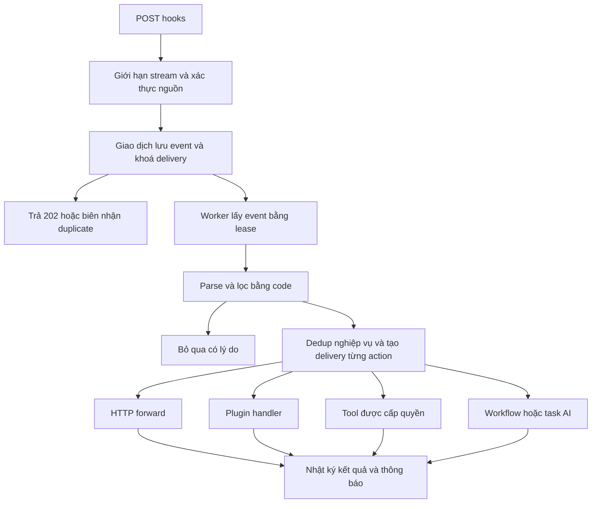

# Đề xuất nâng cấp webhook Javis thành cửa nhận và xử lý sự kiện

Ngày: 19/10/2026. Trạng thái: đề xuất để review và chia mốc triển khai.

Mục tiêu là cho POSCake, form, hệ thống thanh toán và các dịch vụ khác gửi sự kiện vào một cửa chung của Javis. Javis lưu bền trước, lọc và định tuyến bằng code, sau đó mới chạy hành động cần thiết. Chỉ những hành động được cấu hình dùng AI mới được gọi model.

Luồng ưu tiên của anh Quý: POSCake → lưu sự kiện → lọc đơn phù hợp → chống trùng → chuyển sang Apps Script và/hoặc plugin poscake-zalo. Những việc có thời gian chờ như hẹn 15 phút, kiểm danh sách chờ duyệt vẫn do plugin quản lý bằng trạng thái bền; webhook không trở thành một workflow engine mới.

## 1. Hiện trạng đã đối chiếu

Code được đọc ở `origin/main`, phiên bản **0.226.0**, commit `f0cbff7b`. Đây là bản Git đã kiểm, không phải xác nhận phiên bản đang chạy trên VPS.

| Vị trí | Hiện trạng và hệ quả |
| --- | --- |
| `server/webhook_triggers.py:154-159` | `_queues`, `_running`, `_rate` nằm trong RAM. Restart mất sự kiện chưa chạy và bộ đếm nhận. |
| `webhook_triggers.py:304-324` | Khoá chống trùng được lưu trước `_enqueue`. Lần đầu bị 429 vẫn có thể giữ khoá, lần retry bị trả duplicate dù chưa chạy. |
| `webhook_triggers.py:326-339` | Giới hạn 30 sự kiện/giờ, 5 phần tử chờ; sự kiện chỉ được thêm vào deque rồi trả 202. |
| `webhook_triggers.py:358-374` | Chỉ có `workflow` và `task`; request được xử lý nền chứ không chờ model ngay trong HTTP request, nhưng mỗi sự kiện được chạy đều đi vào một nhánh AI. |
| `webhook_triggers.py:374` | Có cả `result` lẫn `error` có thể bị coi là done. Kết quả mới phải phân biệt thành công, thất bại và hoàn thành một phần. |
| `webhook_triggers.py:381-408` | Có `[SILENT]`, còn lại thường báo chủ; lịch sử chỉ 20 dòng, kết quả cắt 300 ký tự, không có raw payload bền. |
| `webhook_triggers.py:415-421` | `request.body()` đọc toàn bộ trước khi kiểm kích thước. Bản mới phải chặn ngay trong lúc đọc stream. |
| `server/main.py`, `_webhook_run_workflow`, `_webhook_send` | Đã có đường chạy workflow và báo về chủ. Nên tái sử dụng thay vì viết thêm executor hoặc kênh báo riêng. |
| `server/plugins_host.py:410`, `:444`, `:1180` | Có tool, lifecycle hooks và `fire_hook` best-effort. `fire_hook` không phải giao thức giao sự kiện bền có xác nhận hoàn tất. |
| `server/secrets_store.py` | Có `encrypt_required()` và `encryption_available()`. Dùng cho secret HMAC/outbound; không chấp nhận fallback plaintext cho secret mới. |
| `server/incident_desk.py` | Phân loại sự cố có thể gọi model. Nếu muốn nhánh không AI thực sự không tốn model, phải kiểm cả đường báo lỗi này. |

Đã chạy hai file test webhook hiện có: **2/2 xanh**. Đã tái hiện lỗi chống trùng bằng dependency giả: lần đầu trả `429`, retry cùng khoá trả `200 duplicate=true`, số lần chạy task bằng 0. Bằng chứng nằm tại `exports/reviews/webhook-design-20261019/` trong checkout làm việc `D:\Project\Javis-OS`.

Nhận định cần chỉnh nhẹ so với mô tả ban đầu: webhook hiện đã trả 202 và gọi model ở nền. Phần thiếu là bảo đảm lưu bền và có đường xử lý hoàn toàn bằng code trước khi quyết định gọi AI.

## 2. Lựa chọn kiến trúc

| Phương án | Điểm mạnh | Đánh đổi |
| --- | --- | --- |
| **SQLite trong STATE_DIR, worker trong Javis** | Phù hợp kiến trúc hiện tại; giao dịch chung cho event, dedup, delivery; truy vấn và replay đơn giản | Cần quản lý dung lượng, lease, backup và giới hạn writer |
| File JSONL append-only kèm index | Dễ đọc thủ công, tiện xuất nhật ký | Phải tự giải quyết ghi dở, đồng bộ index, khoá nhiều worker, dedup và replay |
| Broker ngoài như Redis/RabbitMQ hoặc hàng đợi managed | Hợp triển khai nhiều máy và tải lớn | Thêm dịch vụ, vận hành và chi phí; chưa cần cho luồng hiện tại |

**Đề xuất chọn SQLite**, một kho `STATE_DIR/webhook_events.sqlite3` trên đĩa local. JSONL chỉ là định dạng xuất nhật ký, không là nguồn sự thật. Không đưa kho vào brain hoặc Git sync.

Ba tầng về sản phẩm:

1. **Nhận và lưu:** giới hạn đầu vào, xác thực nguồn, lưu raw bytes và biên nhận.
2. **Hiểu sự kiện bằng luật:** parse, chuẩn hoá, lọc, chống trùng nghiệp vụ và lập danh sách hành động.
3. **Thực thi:** chuyển tiếp, giao plugin, gọi tool hoặc enqueue workflow/task AI.



## 3. Các bảo đảm cần giữ

- Chỉ trả 202 sau khi giao dịch lưu event commit thành công. Hết đĩa hoặc kho lỗi phải trả lỗi có thể retry; không báo đã nhận.
- Không giữ khoá chống trùng cho một sự kiện mà Javis chưa nhận bền. Sửa lỗi 429/dedup hiện tại ngay ở mốc đầu.
- Thiết kế giao ít nhất một lần và chống tác động trùng theo khả năng từng bên nhận. Không hứa exactly-once cho thao tác bên ngoài.
- Một sự kiện có nhiều delivery độc lập. Nhánh chuyển tiếp đã thành công không chạy lại chỉ vì workflow hoặc plugin lỗi.
- Cấu hình dùng để xử lý được chụp theo revision. Retry không tự đổi URL, tool, filter hoặc plugin do cấu hình vừa được sửa.
- Quyền hiện tại vẫn được kiểm trước mỗi tác động. Snapshot cấu hình không giữ lại quyền đã bị chủ thu hồi.
- Không dùng model để parse JSON, so trạng thái, tìm chuỗi, điền mẫu, dedup, retry hoặc dựng thông báo mặc định.
- Không có giới hạn hàng chờ 5 trong RAM, nhưng luôn có giới hạn dung lượng nhận, backlog, concurrency và lưu trữ.

## 4. Lưu trữ và giao dịch nhận sự kiện

### 4.1 Các bảng đề xuất

Tên bảng và trường dưới đây là hợp đồng thiết kế, chưa phải migration đã triển khai.

| Bảng | Nội dung chính |
| --- | --- |
| `hook_revisions` | `hook_id`, `revision`, brain, cấu hình không chứa secret rõ, thời điểm và người sửa |
| `events` | `event_id`, `hook_id`, revision, source, `received_at`, `raw_body` BLOB, content type, SHA-256, headers cho phép lưu, trạng thái parse/lọc, `verified_at`, key version, correlation, lease và thời điểm chạy tiếp |
| `receipts` | Các lần bên gửi giao tới, provider delivery/message ID, event tham chiếu, thời điểm, kết quả nhận; duplicate chỉ thêm metadata ngắn khi còn quota |
| `dedup_keys` | namespace, hook, policy version, key hash, event gốc và `expires_at`; ràng buộc unique cho khoá đang tồn tại |
| `deliveries` | Event, action ID, generation, snapshot action, trạng thái, attempt, `next_attempt_at`, lease owner/token, deadline, outcome và downstream receipt |
| `attempts` | Mỗi lần chạy: thời gian, worker, request hash, HTTP status hoặc mã lỗi, kết quả giới hạn kích thước, dấu tác động có thể đã xảy ra |
| `notifications` | Thông báo/digest cần gửi, khoá chống trùng, trạng thái giao và lỗi riêng |

`UNIQUE(event_id, action_id, generation)` ngăn worker dựng trùng một delivery. Chỉ mục chính: event theo `(state, next_attempt_at)`; delivery theo `(state, next_attempt_at)`; lịch sử theo `(hook_id, received_at, event_id)`; dedup theo namespace/key và hạn hết hiệu lực.

SQLite dùng WAL, `foreign_keys=ON`, `busy_timeout` hữu hạn và `synchronous=FULL` cho kết nối ghi nhận. I/O chạy ngoài event loop; không giữ giao dịch trong lúc gọi mạng/model. WAL/FULL được chọn để tăng độ bền qua mất điện, vẫn phụ thuộc tính đúng đắn của storage. Backup dùng SQLite backup API hoặc snapshot nhất quán, không copy riêng file `.sqlite3` đang có WAL. [S1]

Raw body mặc định nằm ngay trong giao dịch SQLite để tránh khoảng hở giữa ghi file và ghi DB. Chỉ tách blob ra ngoài khi số đo chứng minh cần; việc đó phải có thiết kế phục hồi riêng.

Kho và backup chỉ cấp quyền đọc cho tài khoản chạy Javis/chủ máy; raw payload có thể chứa thông tin khách hàng. Không đưa body vào access log, exception chung hoặc model triage. Mã hoá payload at rest là lựa chọn triển khai cần chốt theo môi trường; việc mã hoá secret không đồng nghĩa payload đã được mã hoá.

### 4.2 Trình tự ingress

1. Tìm hook, áp giới hạn request global và theo hook, đọc body theo stream có trần. `Content-Length` chỉ là gợi ý, không phải hàng rào duy nhất.
2. Kiểm xác thực nguồn bằng verifier đã cấu hình. Không đưa cookie/dashboard credential vào đường nhận public.
3. Xác định provider message ID/delivery ID và revision hook. Với verifier cần chuẩn hoá JSON, parse chỉ phục vụ đúng thuật toán của provider.
4. Trong một giao dịch ngắn: kiểm hook/revision còn được phép nhận, xoá khoá dedup đã hết hạn cần thiết, kiểm delivery key, kiểm quota dung lượng, ghi event cùng khoá delivery nếu là mới. Không ghi toàn bộ cấu hình JSON cũ mỗi lần nhận.
5. Commit rồi trả biên nhận. Worker được đánh thức, nhưng việc đánh thức bị mất không làm mất event: worker luôn quét lại DB.

| Trường hợp | HTTP và hành vi |
| --- | --- |
| Event mới lưu thành công | `202 {accepted:true,event_id,state:"received"}` |
| Duplicate đã có event bền | `200 {duplicate:true,event_id:<gốc>}`; không tạo hành động mới |
| Không xác thực, hook lạ hoặc tắt nhận | Giữ hành vi tương thích 401, không lưu raw của request không xác thực |
| Body vượt trần | 413 ngay khi vượt trần, không đọc tiếp không giới hạn |
| Rate ingress hoặc backlog vượt ngưỡng | 429 kèm Retry-After; không giữ dedup mới |
| Kho lỗi, busy quá thời gian nhận hoặc hết đĩa | 503 kèm mã lỗi an toàn; không trả 202 |

Payload đã xác thực nhưng không parse được theo contract được lưu và đưa `quarantined`, không gọi AI. Với nguồn mà không thể xác thực nếu JSON hỏng, trả lỗi xác thực tương ứng; không giả vờ đã xác thực. Loại nội dung không hỗ trợ bị từ chối rõ trước khi tạo action.

## 5. Bộ lọc và chuẩn hoá không cần model

Không dùng `eval`, JavaScript tuỳ ý, Python expression hoặc template có khả năng gọi hàm. Dùng biểu thức dữ liệu có schema và giới hạn độ sâu/số điều kiện.

Các phép so sánh ở bản đầu: `eq`, `ne`, `in`, `exists`, `gt/gte/lt/lte`, `contains`, `all`, `any`, `not`, và phần tử mảng qua đường dẫn `[*]`. Regex tuỳ ý chưa nằm trong mốc đầu để tránh bộ lọc tốn CPU không kiểm soát.

```json
{
  "all": [
    {"path": "status", "op": "eq", "value": 1},
    {"path": "items[*].name", "op": "contains", "value": "TRỢ LÝ AI JAVIS", "quantifier": "any", "case_sensitive": false}
  ]
}
```

Quy tắc rõ kiểu: `1` khác `"1"`; trường thiếu là missing, không tự đổi thành null/0/chuỗi rỗng. Muốn nhận dữ liệu nhiều dạng phải khai bước chuẩn hoá cụ thể. `contains` trên mảng phải chỉ rõ `any` hoặc `all`; không so chuỗi bằng cách stringify cả object.

Giới hạn parser, thí dụ JSON sâu tối đa 64 tầng và bộ lọc tối đa 100 node, là giá trị đề xuất để benchmark. Sai filter không được coi như match-all: cấu hình sai bị từ chối khi lưu; lỗi runtime đưa event vào quarantine có lý do.

Mỗi lần đánh giá lưu rule version, kết quả từng điều kiện cần thiết và lý do ngắn: `status_mismatch`, `product_not_found`, `missing_field`. Không lưu PII nhiều lần vào trace.

Dashboard có **Kiểm bộ lọc**: dán một payload, thấy các trường được chọn, kiểu dữ liệu và điều kiện nào không khớp. Mặc định chỉ mô phỏng, không tạo task, không gửi mạng và không giữ dedup thật.

## 6. Chống trùng ở hai cấp và xử lý sự kiện đến sai thứ tự

### 6.1 Delivery trùng

Ưu tiên ID mà provider định nghĩa là message/event bền qua retry. Không nhầm attempt ID thay đổi ở mỗi lần gửi với event ID. Nếu dùng header tuỳ chọn, tài liệu UI phải nói rõ nó có bền qua retry hay không.

Scope khoá luôn gồm hook và loại chính sách. Cùng một ID ở hai hook không được chặn nhau. Delivery dedup và event insert ở cùng giao dịch.

### 6.2 Tác động nghiệp vụ trùng

Sau khi filter khớp mới tính khoá nghiệp vụ, rồi trong một giao dịch ghi khoá và tạo các delivery. Ví dụ: `(shop_id, order_id, status)` hoặc `(shop_id, order_id, event_type, source_version)`.

- Serialize tuple có kiểu trước khi hash; không nối chuỗi bằng dấu `+` gây va chạm như `1+23` và `12+3`.
- Nếu trường bắt buộc của khoá thiếu: đưa vào quarantine, không dùng khoá rỗng chặn mọi đơn sau đó.
- Chọn TTL rõ. Mặc định đề xuất 7 ngày; mẫu nguồn có retry dài có thể cần dài hơn. Dữ liệu dedup tối thiểu có thể giữ lâu hơn payload.
- `id + status` phù hợp với tác động muốn chạy một lần cho mỗi trạng thái. Nó không phù hợp nếu cùng trạng thái có lần cập nhật hợp lệ cần chạy lại; lúc đó thêm event/version hoặc dùng chính sách transition do plugin quản lý.
- Event bị filter loại không chiếm khoá nghiệp vụ, nhưng vẫn có biên nhận delivery để nhận biết gửi lặp.
- Trùng nội dung toàn body chỉ là chế độ fallback ngắn hạn có chủ đích; không dùng mặc định để thay ID nghiệp vụ.

FIFO trong Javis chỉ là thứ tự nhận, không chứng minh thứ tự sự kiện ở nguồn. Stripe cũng không bảo đảm thứ tự giao. [S2] Trạng thái đơn đảo chiều không được bị lõi tự suy luận là lỗi. Plugin nghiệp vụ có thể so version nguồn, đối soát API hoặc thực thi transition hợp lệ.

## 7. Worker bền và retry từng hành động

Worker lấy event/delivery bằng CAS trong DB và lease có fencing token. `asyncio.Lock` chỉ là tối ưu trong một tiến trình. Lease được gia hạn khi xử lý còn chạy; worker cũ mất lease không được chốt kết quả hoặc dispatch tác động mới.

Hai worker hoặc hai lần startup không được cùng lấy một delivery. Nếu worker cũ còn có request mạng đang bay lúc mất lease, fencing không thu hồi được request đã ra ngoài: chống trùng phía nhận và phân loại kết quả chưa rõ vẫn bắt buộc.

Trạng thái delivery:

`pending → running → succeeded | retry_wait | waiting_result | waiting_approval | blocked | unknown | dead | cancelled`.

- `waiting_result`: bên nhận đã chấp nhận công việc bền, có job/receipt ID, chưa phải nghiệp vụ hoàn tất.
- `unknown`: không biết tác động ngoài đã xảy ra hay chưa. Không tự coi là failed rồi gửi lại thao tác không an toàn.
- Event tổng hợp thành `ignored`, `processing`, `waiting`, `done`, `partial_failed`, `failed` hoặc `cancelled` theo các action, không lấy câu trả lời cuối làm trạng thái chung.

Lịch retry mặc định đề xuất: sau lỗi lần đầu chờ 1 phút; lỗi tiếp chờ 5 phút; lỗi tiếp chờ 30 phút. Tổng tối đa **4 lần gọi** gồm lần đầu. Thêm jitter ±20%; test dùng đồng hồ và RNG giả. `Retry-After` hợp lệ có thể kéo dài khoảng chờ trong deadline cấu hình.

| Kết quả | Chính sách |
| --- | --- |
| DNS/kết nối hỏng trước khi gửi request | Retry theo lịch |
| HTTP 429/5xx, timeout sau khi gửi | Retry chỉ khi action có idempotency phía nhận hoặc chủ đã chọn chấp nhận giao ít nhất một lần; nếu không, chuyển unknown khi có khả năng đã có tác động |
| 401/403, thiếu credential, plugin bị tắt | Blocked, chờ sửa quyền/cấu hình; không spam retry |
| Payload/schema/filter sai | Quarantined hoặc dead, không gọi model để tự sửa |
| Engine chưa được gọi vì hết quota | Chờ quota; không tính như đã gọi model |
| Model/tool đã có tác động nhưng trả lỗi | Theo checkpoint của executor; không chạy lại toàn bộ chuỗi mù quáng |
| Worker chết lúc running | Thu hồi lease; retry nếu chứng minh an toàn, nếu không unknown và cần đối soát |

Một forward thành công + plugin thất bại: chỉ plugin được retry. Không có rollback toàn cục tự động cho các tác động đã ra ngoài. Hành động bù chỉ là action rõ ràng có quyền và bằng chứng riêng.

Dashboard **Chạy lại** mặc định chỉ retry action lỗi/chưa rõ sau khi đã chọn cách đối soát, giữ nguyên snapshot và business identity. **Xử lý theo cấu hình mới** tạo generation mới, chạy mô phỏng và cho thấy tác động nào có thể lặp; không âm thầm bỏ dedup.

## 8. Các loại hành động

### 8.1 Chuyển tiếp HTTP

- URL và phương thức do chủ cấu hình, không lấy URL trực tiếp từ payload. Bản đầu hỗ trợ POST.
- `body_mode=raw` gửi nguyên bytes đã nhận và content type tương ứng. Chế độ JSON mapping là lựa chọn riêng, không được ghi là nguyên văn.
- Chỉ chuyển các header được phép. Không tự mang Authorization, cookie, token nhận hoặc header proxy của request nguồn sang đích.
- Có outbound credential riêng, timeout và giới hạn response. Gửi stable `Idempotency-Key`/`X-Javis-Event-Id` nếu đích hỗ trợ, nhưng header không làm đích tự nhiên có khả năng chống trùng.
- Đích public phải HTTPS, kiểm TLS. Kiểm URL, IP sau DNS và mỗi redirect; không để payload dùng Javis gọi địa chỉ metadata hoặc dịch vụ nội bộ không được cấp. Đích private chỉ dùng cấu hình LAN rõ ràng của chủ.
- Mặc định không follow redirect tuỳ ý. Hồ sơ Apps Script cho phép redirect có giới hạn từ `script.google.com` sang `script.googleusercontent.com`, kiểm host/IP từng chặng và không mang credential sang host mới.

**Apps Script:** Content Service chuyển response sang URL một lần trên `script.googleusercontent.com`. [S6] Cần test cả redirect và nội dung response. Không gửi lại POST ban đầu chỉ vì đọc response redirect thất bại: `doPost` có thể đã chạy. Bên nhận phải có hợp đồng chống trùng và biên nhận; web app trả trang đăng nhập hoặc HTTP 200 kèm `{"ok":false}` không được coi là thành công nghiệp vụ.

Nếu giữ raw payload để tương thích Apps Script đang dùng, phải thống nhất cách đích nhận idempotency trước khi bật auto-retry. Có thể dùng trường đã có như order/status hoặc mode envelope/query metadata được chủ chấp thuận; không tự nhét thêm trường làm thay đổi schema cũ. Chi tiết cơ chế đọc header của Apps Script phải kiểm bằng adapter thực tế, không giả định mọi header có sẵn trong `doPost(e)`.

### 8.2 Giao plugin

Đề xuất thêm `register_event_handler(name, handler, schema, min_mode)` vào PluginContext, lưu handler trong LoadedPlugin và gỡ khi plugin bị tắt. Đây là API mới, không phải API đã tồn tại.

Không dùng `fire_hook()` best-effort để dispatch sự kiện nghiệp vụ. Delivery phải chọn **đúng plugin + handler** đã được chủ bind, không broadcast raw payload tới mọi plugin.

Envelope gồm event ID, delivery ID, attempt, source, brain, config revision, verified metadata, parsed payload, raw hash và business key. Handler nhận context quyền và idempotency đã cấp; không nhận cookie của chủ hay signing secret nguồn.

Handler trả một trong:

- `completed`: đã xử lý, receipt/kết quả ngắn;
- `accepted`: plugin đã lưu công việc bền, trả plugin job ID và đường đối soát;
- `retryable_error`, `permanent_error`, `unknown`, `waiting_approval`.

Plugin chỉ được trả accepted sau khi commit state của mình. Crash sau plugin commit trước core ghi receipt được xử lý bằng stable delivery ID: plugin trả lại cùng job ID, không tạo việc 15 phút lần hai. Core không thể đảm bảo giao dịch xuyên hai kho nếu plugin không thực hiện hợp đồng này.

Handler phải khai có dùng AI hay không. Handler được gắn nhãn không AI phải được kiểm cùng đường gọi phụ của nó; không thể bảo đảm plugin Python tuỳ ý không tự gọi API bên ngoài chỉ bằng việc core không dựng model. Handler có AI phải dùng ledger/ngân sách và được chủ bật rõ trong binding.

poscake-zalo giữ việc chờ duyệt, hẹn, quét API và chống gửi Zalo trùng trong kho plugin. Lõi chịu nhận, xác thực, lưu, định tuyến, retry giao và quan sát kết quả. Plugin timeout không được để callback cũ chạy song song tác động với retry mới.

### 8.3 Gọi tool trực tiếp

Gọi qua đường dispatch/tool guard chung của Javis: plugin enabled, schema, `min_mode`, scope brain và check readiness. Không gọi thẳng Python handler để bỏ qua hàng rào hiện có.

Tool và tài khoản/đích phải được chủ chọn trong cấu hình. Payload chỉ điền các tham số đã mở. Mẫu `{{payload.bill_full_name}}` là đường dẫn dữ liệu; không có hàm, import, shell, đọc secret hoặc template engine tuỳ ý. Mảng/object giữ kiểu khi toàn trường là một biểu thức. Trường thiếu báo lỗi, không tự dùng rỗng cho người nhận tin, số tiền hoặc ID.

Các tool như gửi tin hoặc thêm dòng Sheet phải khai khả năng chống trùng/đối soát. Timeout sau tác động mà không có receipt không được tự thử lại. Chọn tool từ danh sách đã kết nối; `zalo_send_message` là ví dụ nhu cầu, không cam kết tên này có ở mọi máy.

### 8.4 Workflow và task dùng AI

Giữ tương thích hai target cũ nhưng biểu diễn thành action trong cấu hình mới. Enqueue vào cơ chế việc bền có idempotency, trả job ID để theo dõi. Không chỉ gọi lại hàm model cũ trong một task RAM rồi coi như đã có persistence.

Webhook executor lưu checkpoint dispatch; retry giao không tạo hai Kanban/workflow job. Lượt đã bắt đầu có tác động được phục hồi theo executor hiện có, không tự tạo một workflow mới để thay thế.

Gắn event/delivery ID vào ledger và prompt. Payload là dữ liệu không đáng tin; quyền lấy từ cấu hình của chủ. Workflow cần người quyết thì giữ `waiting_approval`/waiting, không chốt done và không đưa sang nhánh gọi lại vô hạn.

### 8.5 Một hook nhiều hành động

Mỗi action có ID bền, `when` tuỳ chọn và `depends_on`. Bản đầu chỉ cần danh sách độc lập hoặc phụ thuộc không vòng, không cần đồ thị workflow tổng quát.

Nhánh độc lập mặc định không chặn nhau. Nhánh phụ thuộc chỉ bắt đầu khi điều kiện thành công đã xác định đúng: “đã được bên nhận xếp hàng” khác “đã hoàn tất nghiệp vụ”. Giới hạn tối đa 10 action/hook ở bản đầu, điều chỉnh sau số đo.

## 9. Mẫu cấu hình minh hoạ cho POSCake

Các trường `shop_id`, `id`, `status`, `items[*].name` và ý nghĩa `status=1` dưới đây lấy từ nhu cầu anh nêu để minh hoạ. Phải đối chiếu payload đã che dữ liệu thật và tài liệu POSCake trước khi xuất bản preset; không đoán trạng thái đơn hoặc phương thức xác thực.

```json
{
  "schema_version": 2,
  "id": "wh_orders_example",
  "revision": 1,
  "name": "Đơn có sản phẩm Javis",
  "brain": "<brain hiện hữu do chủ chọn>",
  "enabled": true,
  "source": "poscake",
  "auth": {"type": "token", "header": "X-Javis-Token", "token_hash": "<hash do host tạo>"},
  "filter": {
    "all": [
      {"path": "status", "op": "eq", "value": 1},
      {"path": "items[*].name", "op": "contains", "value": "TRỢ LÝ AI JAVIS", "quantifier": "any", "case_sensitive": false}
    ]
  },
  "dedup": {"policy_version": 1, "business_paths": ["shop_id", "id", "status"], "ttl_s": 604800, "missing": "quarantine"},
  "ordering": {"concurrency": 1},
  "limits": {"body_bytes": 262144, "ingress_per_minute": 300, "pending_events": 10000, "ai_calls_per_hour": 30},
  "retry": {"delays_s": [60, 300, 1800], "jitter_ratio": 0.2, "max_attempts": 4},
  "notifications": {"mode": "errors_only", "digest_timezone": "Asia/Saigon", "ai_triage": false},
  "actions": [
    {
      "id": "to_apps_script", "type": "http_forward", "endpoint_ref": "apps_script_orders",
      "body_mode": "raw", "redirect_profile": "google_apps_script",
      "retry_safety": "manual_on_ambiguous", "depends_on": []
    },
    {
      "id": "to_poscake_zalo", "type": "plugin", "plugin": "poscake-zalo",
      "handler": "order_received", "grant_ref": "owner_hook_grant", "depends_on": []
    }
  ]
}
```

Ví dụ là schema đích đề xuất, không được dán vào `webhooks.json` hiện tại rồi mong chạy. Các giá trị trong dấu `<...>` là trường UI/host phải điền; chúng không phải credential mẫu để dùng thật. Token/URL/tool/plugin binding được kiểm trước khi bật hook. Tên `order_received` là hợp đồng adapter cần triển khai, không khẳng định plugin hiện có handler này.

Luồng này có **0 action AI**. Chỉ thêm action AI khi chủ muốn xử lý nội dung cần suy luận. Hai nhánh ví dụ độc lập; nếu Zalo chỉ được gửi sau khi Apps Script đã ghi thành công, phải khai phụ thuộc receipt nghiệp vụ tương ứng.

## 10. Xác thực nguồn và quản lý secret

Không thể gom mọi provider vào một công thức “HMAC raw body” duy nhất. Chốt verifier theo source profile; không cho payload tự chọn thuật toán, header hoặc secret.

| Nguồn | Profile đề xuất và điểm cần giữ |
| --- | --- |
| Generic token | Bearer hoặc header do chủ chọn; query token chỉ giữ cho hook cũ, cảnh báo trong UI về log URL; lưu hash để kiểm token |
| GitHub | `X-Hub-Signature-256`, HMAC-SHA256 với raw body, digest dạng hex có prefix `sha256=`; delivery ID từ `X-GitHub-Delivery` [S3] |
| Shopify | `X-Shopify-Hmac-SHA256`, HMAC-SHA256 raw body, digest base64; dùng webhook ID theo tài liệu provider, không sửa JSON trước khi kiểm [S4] |
| Stripe | `Stripe-Signature`, chữ ký trên timestamp + dấu chấm + raw body, nhận đúng scheme/version và kiểm độ mới; ưu tiên SDK chính thức [S2] |
| Systeme.io | `X-Webhook-Signature`; tài liệu yêu cầu HMAC-SHA256 trên JSON được chuẩn hoá theo cách của Systeme, gồm Unicode và slash escaping. Dedup theo `X-Webhook-Message-Id`, không lấy attempt ID [S5] |
| POSCake | Chỉ phát hành preset verified sau khi có payload/header/tài liệu nguồn đúng phiên bản. Nếu sender không gửi header tuỳ chọn, phải chọn cơ chế mà sender thật sự hỗ trợ; không tự bỏ xác thực |

Với Systeme, không dùng JSON sort-key chung hoặc thay thế Unicode tuỳ ý. Viết golden tests từ ví dụ chính thức và delivery fixture; profile chưa vượt kiểm tương thích thì không gắn nhãn đã hỗ trợ production. Stripe/GitHub/Shopify giữ raw bytes bất biến, khác phần chuẩn hoá để lọc hoặc dedup.

Signing secret cần giải mã để tính HMAC, nên không thể chỉ lưu hash như bearer token. Dùng secret mã hoá bắt buộc bằng `secrets_store.encrypt_required()` và tham chiếu từ config. Thiếu key giải mã: block với lỗi rõ, không fallback bỏ kiểm.

Hỗ trợ quay vòng hai key trong thời gian chồng lấn hữu hạn. Lưu key version và thời điểm xác thực, không đưa secret vào log, prompt, raw export hoặc HTTP response.

Replay nội bộ xử lý event đã xác thực trong DB theo quyền quản trị, không giả làm một request mới có timestamp chữ ký còn hạn. Không sửa timestamp rồi giả mạo chữ ký nguồn để chuyển tiếp.

## 11. Giới hạn tài nguyên và công bằng giữa hook

Tách **khả năng nhận**, **tốc độ thực thi hành động** và **ngân sách AI**. Bỏ việc dùng 30/giờ để chặn tất cả sự kiện sau khi đã có xử lý bằng code; không bỏ bảo vệ request và đĩa.

Giá trị khởi tạo đề xuất, chưa phải số đo năng lực máy:

| Giới hạn | Mặc định mới đề xuất |
| --- | --- |
| Body mỗi hook | 256 KiB, chủ chỉnh trong hard ceiling global 2 MiB |
| Ingress hợp lệ mỗi hook | 300/phút với burst riêng; có giới hạn global/IP cho request không xác thực |
| Backlog mỗi hook | 10.000 event hoặc 256 MiB, chạm ngưỡng nào trước thì dừng nhận mới |
| Dung lượng DB tổng | 1 GiB để cảnh báo/dừng nhận theo dự toán; kiểm cả WAL, dung lượng trống và kết quả ghi thực tế |
| AI mỗi hook | 30 lượt/giờ mặc định cho hook mới có AI; có trần global và bộ đếm bền |
| Concurrency | 1/hook để tương thích; pool global hữu hạn, chia lượt công bằng |
| Raw payload | 7 ngày mặc định; lỗi/unknown được giữ tới khi xử lý hoặc chủ chủ động xoá, vẫn tính vào quota |
| Metadata và dedup | 30 ngày metadata; dedup theo TTL đã chọn, không bị xoá chỉ vì payload được dọn |

Khi backlog đầy, vẫn có thể xác nhận duplicate của event còn giữ mà không phải tạo thêm raw body. Không xả hoặc xoá pending để lấy chỗ. Expiry nghiệp vụ phải cấu hình rõ và đưa sang expired/dead có audit, không gửi đơn cũ sau nhiều ngày mà chủ không biết.

Một hook lỗi hoặc plugin chậm không chiếm hết worker. Circuit breaker theo đích/credential giúp tạm hoãn các delivery cùng nguyên nhân; chưa làm đích đó khoẻ hơn thì không tạo thêm đợt gọi model hỏi cách retry.

Thứ tự theo khoá đơn hàng là tính năng mở rộng sau mốc đầu: partition key `(shop, order)` giúp nhiều đơn chạy song song. Nó vẫn không sửa được thứ tự sai từ nguồn; version/transition là nghiệp vụ plugin.

## 12. Nhật ký và thông báo

Trang hook có ba phần: **Cấu hình**, **Sự kiện**, **Tình trạng**. Giữ cách cấu hình đơn giản cho người chỉ muốn chạy workflow cũ; mục nâng cao mới hiện filter/dedup/actions.

Mỗi event có timeline: nhận, xác thực, parse, filter, duplicate, action dispatch, attempt, receipt, kết quả và thông báo. Danh sách có cursor pagination, lọc theo hook/trạng thái/order ID/correlation và khoảng thời gian; không đọc cả DB vào RAM.

Các nút:

- **Kiểm bộ lọc/mapping:** mô phỏng mặc định, không tác động ngoài.
- **Gửi thử thật:** chỉ dùng payload do chủ chọn, hiện danh sách tác động trước khi gửi; tạo test event có namespace riêng, vẫn áp quyền và quota.
- **Chạy lại action lỗi:** giữ delivery identity và snapshot.
- **Xem raw payload / Xuất:** quyền riêng theo brain; mặc định mask thông tin khách hàng và credential, audit việc xem/xuất raw.
- **Tạm dừng xử lý:** vẫn nhận và lưu trong quota. Khác **Tắt nhận:** từ chối request mới. UI phải phân biệt hai công tắc.

Thông báo cấu hình: `all`, `errors_only`, `daily_digest`, `none`. Hook cũ giữ hành vi all; hook mới không AI mặc định errors_only.

Digest dựng bằng code, theo timezone chủ chọn; có cursor và khoá chống gửi lặp, khởi động lại chỉ gửi bù tối đa một bản cho một kỳ. Lỗi gửi thông báo chỉ retry notification, không chạy lại action.

`none` tắt tin hoạt động của hook, không tắt cảnh báo hệ thống như hết đĩa. Với `errors_only`, gộp lỗi lặp thành một incident và chỉ báo lại khi chuyển trạng thái đáng chú ý. `ai_triage=false` phải ngăn cả model phân loại incident; nếu bật riêng, lượt triage vào ledger/ngân sách và hiện rõ trên UI.

Chỉ số tình trạng: số nhận/match/ignored/duplicate, backlog, tuổi event cũ nhất, latency nhận, latency xử lý, retry/dead/unknown, SQL busy, dung lượng DB/WAL, AI calls và số lỗi theo đích. `202 đã nhận` không được trình bày như `đơn đã xử lý xong`.

## 13. Phân chia module và tương thích

| Thành phần | Trách nhiệm |
| --- | --- |
| `webhook_triggers.py` | Giữ router/adaptor API tương thích, uỷ quyền ingress và quản trị; tránh phình thành toàn bộ hệ thống |
| `webhook_store.py` mới | Transaction, schema, dedup, revision, lease, attempt và truy vấn nhật ký |
| `webhook_rules.py` mới | Parse/mapping/filter thuần, kiểm schema và giải thích kết quả |
| `webhook_auth.py` mới | Verifier profile và secret references |
| `webhook_worker.py` mới | Quét DB, claim/renew, lập delivery, retry, tổng hợp trạng thái |
| Adapters action | HTTP, plugin, tool, task/workflow; tách khi logic đủ lớn, không buộc tạo một file cho mỗi hàm |
| `plugins_host.py` | Đăng ký event handler có contract, enabled state và scope |
| `main.py` | Wiring/startup/shutdown và các service đã có, không chứa logic webhook nghiệp vụ |
| Dashboard webhook hiện có | Cấu hình v2, log, simulate/retry, trạng thái chờ và dung lượng |

Migrate `webhooks.json` vào SQLite trong bước có version/idempotency: giữ ID hook, token hash, brain, tên, target, mức quyền, chat đích và trạng thái enabled. Snapshot file cũ trước migration, ghi marker sau khi migration hoàn tất. Lịch sử cũ chỉ là legacy summary, không bịa raw payload hoặc khả năng replay cho quá khứ.

Hook cũ thành một action AI, không tự thêm filter, không tự đổi quyền `full` cũ. UI nhắc kiểm quyền khi chủ sửa cấu hình; không âm thầm làm hỏng tích hợp đang chạy. Với `seen_keys` cũ, không thể phân biệt khoá nào thuộc request 429 đã mất: giữ như tombstone legacy có hạn và ghi hạn chế; phục hồi sự kiện mất cần đối soát nguồn.

Giữ public endpoint `POST /hooks/{id}` và các route quản trị cũ qua adapter. Event API mới nằm dưới `/webhooks/...`, không đặt vào prefix public `/hooks/`. Quản trị, raw export và replay bắt buộc kiểm quyền/brain như dữ liệu nguồn.

Khi rollback về code cũ, không để binary cũ âm thầm dùng `webhooks.json` stale song song DB mới. Công cụ rollback phải dừng worker, xử lý hoặc export backlog, dựng config legacy rõ ràng và báo sự kiện nào không thể chạy bằng bản cũ. DB v2 được giữ nguyên để phục hồi; không tuyên bố downgrade bảo toàn replay nếu chưa kiểm.

## 14. Thứ tự triển khai

**M1 - Nhận bền và quan sát tối thiểu.** SQLite, giao dịch accept/dedup, worker/lease, chuyển hai action AI cũ qua đường dispatch bền, retry an toàn, dead/unknown và trang danh sách sự kiện cơ bản. Sửa lỗi 429 giữ dedup. Có test crash trước/sau commit. Không đợi tới mốc cuối mới có nút xem lỗi/retry.

**M2 - Filter và dedup nghiệp vụ.** Bộ biểu thức thuần, giả lập payload, composite key có kiểu, TTL và trace. Đây là phần cần đi cùng luồng POSCake trước khi chuyển traffic thật.

**M3 - HTTP forward và plugin delivery.** Fan-out theo action, adapter Apps Script, plugin handshake/idempotency, nhánh không AI kể cả báo lỗi. Đạt mốc này mới đủ điều kiện chuyển POSCake sang cửa lõi; cần M1 + M2 + M3, không bỏ dedup khỏi ba việc ưu tiên.

**M4 - Verifier nguồn và tool trực tiếp.** Profile ký webhook, quay vòng secret, mapping có schema, tool guard, biên nhận và chờ duyệt. Generic custom header token có thể làm sớm nếu là điều kiện POSCake thực tế.

**M5 - Hoàn thiện vận hành.** Digest, retention/export, quota tuning, circuit breaker, phân vùng thứ tự nếu cần, migration/rollback toàn chuỗi và tài liệu nguồn verified.

Mỗi mốc có test, bằng chứng và PR riêng theo số phiên bản được reserve trong repo. Không ghi cứng số phát hành tương lai trong spec vì các phiên khác vẫn đang ra bản mới.

## 15. Ma trận kiểm thử bắt buộc

| Nhóm | Ca cần kiểm và kết quả yêu cầu |
| --- | --- |
| Lưu bền | Kill process sau commit/trước 202; sender retry lấy cùng event, không mất event |
| Lưu bền | Kill trước commit hoặc kho đầy: không trả 202, không giữ dedup mới |
| Phục hồi | Restart với pending/retry_wait/running; xử lý đúng lease, không chạy hai worker cùng delivery |
| Chống trùng | Ca 429 + cùng key như bug hiện tại: lần retry sau khi hết chặn phải được nhận thật |
| Chống trùng | Hai request đồng thời, cùng event ID: một event, một bộ delivery |
| Chống trùng | Composite key có kiểu, thiếu trường, TTL, khác hook, event trạng thái khác và cập nhật hợp lệ cùng trạng thái |
| Filter | Status number/string, item match/no match, mảng rỗng, null/missing, Unicode, JSON quá sâu |
| Filter | Sai rule không thành match-all, ignored không mở AI/tool/plugin |
| Nhận body | Streaming vượt trần, Content-Length giả/không có, body không UTF-8 và form legacy |
| Xác thực | Sai/mất header, ký sai 1 byte, quay key, timestamp cũ và constant-time compare |
| Provider | GitHub hex prefix; Shopify base64/raw; Stripe timestamp nhiều signature; Systeme Unicode/slash normalization |
| Chuyển tiếp | Raw bytes y nguyên, không rò cookie/token; DNS/redirect sang private bị chặn |
| Apps Script | Redirect hợp lệ, trang đăng nhập, HTTP 200 nghiệp vụ lỗi, POST đã chạy nhưng mất response; không tạo đơn trùng |
| Retry | Đồng hồ giả cho 1/5/30 phút, jitter, Retry-After, hết attempt, unknown không tự gửi lại action nguy hiểm |
| Fan-out | Forward succeeded + plugin failed: retry plugin, forward không lặp |
| Plugin | Commit job rồi crash trước receipt; cùng delivery trả cùng job ID, không hẹn/gửi lần hai |
| Plugin | Plugin disabled/uninstalled, handler sai schema, callback timeout, brain khác; không broadcast payload |
| Tool | Schema, min_mode, readiness, tài khoản/đích đã bind; payload không chọn tool hoặc tăng quyền |
| AI  | Hết quota chờ; dispatch retry cùng key không tạo hai task; partial result + error không thành done |
| Chờ chủ | Workflow/tool cần quyết định không chạy tiếp hoặc bị coi done |
| Không AI | Toàn luồng filter + forward/plugin, cả lỗi và digest, số lần dựng/gọi model bằng 0 |
| Replay | Action thành công không bị chạy lại; replay mới revision/generation hiển thị rõ tác động và quyền hiện tại |
| UI  | Hai tab, nhiều ngôn ngữ, màn hẹp, dữ liệu khách được mask, pagination, simulate không có side effect |
| Thông báo | Gửi thông báo lỗi không chạy lại action; restart không gửi hai digest cùng kỳ |
| Tải | Hook nghẽn không làm đói hook khác; backlog/byte quota, SQL busy, hết đĩa/WAL, retention không xoá pending |
| Tương thích | Migration chạy hai lần, giữ ID/token/brain/quyền; API cũ; rollback không chạy config cũ song song |

Test qua host/router thật nhưng dùng model giả, HTTP server giả, plugin/tool giả và SQLite tạm. Có chốt fail-fast nếu bất kỳ đường nào dựng model thật; đặt cả guard cho incident triage. Test crash dùng subprocess và đồng bộ bằng barrier, không chỉ đóng/mở connection trong cùng tiến trình.

Test integration với Apps Script/POSCake thật chỉ chạy trên endpoint/state riêng khi chủ giao; không gửi Zalo khách thật để chứng minh code nhận sự kiện.

## 16. Tiêu chí nghiệm thu và chuyển luồng POSCake

1. Mỗi event đã trả 202 đều tìm lại được sau restart và có kết cục hoặc trạng thái chờ rõ ràng.
2. Dữ liệu không khớp, duplicate và lỗi luật không tiêu lượt model. Nhánh forward/plugin không AI không gọi cả model triage ngầm.
3. Retry/replay không lặp lại action đã thành công; tác động chưa rõ được giữ unknown để đối soát.
4. Quota của AI không làm mất đơn đã nhận; backlog đầy trả lỗi cho sender trước khi giữ dedup.
5. Timeline giải thích được vì sao đơn được/không được chạy và ai/handler nào đã nhận.
6. POSCake → Apps Script và POSCake → plugin được kiểm bằng fixture đã che dữ liệu thật và luồng staging có biên nhận.
7. Hook cũ tiếp tục hoạt động; API quản trị/raw/replay không vô tình public.

Đích đo khởi tạo để thử trên máy chuẩn: payload 10 KiB, 5 hook, tổng burst 20 request/giây trong 60 giây; p95 ACK sau commit dưới 250 ms, không mất event đã nhận và không mở model ở nhánh thuần code. Đây là mục tiêu benchmark, không phải số đo hay cam kết VPS hiện tại. Đo riêng ingress với action chậm để không trộn latency nhận và latency nghiệp vụ.

Khi chuyển traffic: tạo hook v2 ở staging, dùng capture/simulation không tác động ngoài để đối chiếu filter; kiểm event ID, auth và schema nguồn; chạy thử các nhánh vào receiver test; chuyển **một** đường nguồn sang v2 và đối soát số đơn/receipt. Không đồng thời bật đường plugin cũ và đường lõi mới cùng gửi Zalo/ghi đơn. Giữ kế hoạch trả traffic về đường cũ cùng dedup/receipt đối soát, vì rollback binary không hoàn tác tác động đã ra ngoài.

## 17. Những dữ liệu cần chốt trước khi bật luồng thật

- Payload và headers POSCake đã che PII, ID shop/order/event, ý nghĩa status và việc sender có gửi custom header hay không.
- Apps Script đang nhận raw schema nào, trả receipt gì và có cơ chế dedup nào; khả năng xử lý redirect và đối soát đơn đã ghi.
- Plugin poscake-zalo hiện lưu hẹn/chờ ở đâu và có thể trả lại cùng job ID khi giao lại hay chưa.
- Tốc độ sự kiện lúc cao điểm, thời gian được phép xử lý trễ, retention và ngân sách đĩa của máy chạy.
- Hành động nào chỉ cần at-least-once, hành động nào bắt buộc đối soát trước khi gửi lại.

Các câu hỏi này không ngăn viết M1/M2 bằng fixture. Chúng là điều kiện hoàn thiện adapter/preset và cắt traffic thật, không được thay bằng suy đoán về dữ liệu kinh doanh.

## 18. Nguồn kỹ thuật

Đối chiếu ngày 19/10/2026. Mã nguồn Javis được chốt ở short SHA `f0cbff7b`; khi triển khai phải fetch và kiểm diff mới hơn.

- Mã nguồn đã đọc: `server/webhook_triggers.py`, phần wiring webhook trong `server/main.py`, `server/plugins_host.py`, `server/secrets_store.py`, `server/incident_desk.py`; test hiện có `tests/python/test_webhook_triggers_0198.py`, `tests/js/test_webhooks_ui_0198.js`.
- [S1 SQLite synchronous](https://www.sqlite.org/pragma.html#pragma_synchronous), [SQLite WAL và backup](https://www.sqlite.org/wal.html).
- [S2 Stripe webhooks: chữ ký, duplicate, ordering và xử lý nền](https://docs.stripe.com/webhooks).
- [S3 GitHub xác thực webhook](https://docs.github.com/en/webhooks/using-webhooks/validating-webhook-deliveries), [headers và delivery](https://docs.github.com/en/webhooks/webhook-events-and-payloads).
- [S4 Shopify verify deliveries](https://shopify.dev/docs/apps/build/webhooks/verify-deliveries).
- [S5 Systeme.io webhooks: signature normalization và message ID](https://developer.systeme.io/docs/webhooks).
- [S6 Google Apps Script Content Service](https://developers.google.cn/apps-script/guides/content?hl=en).
